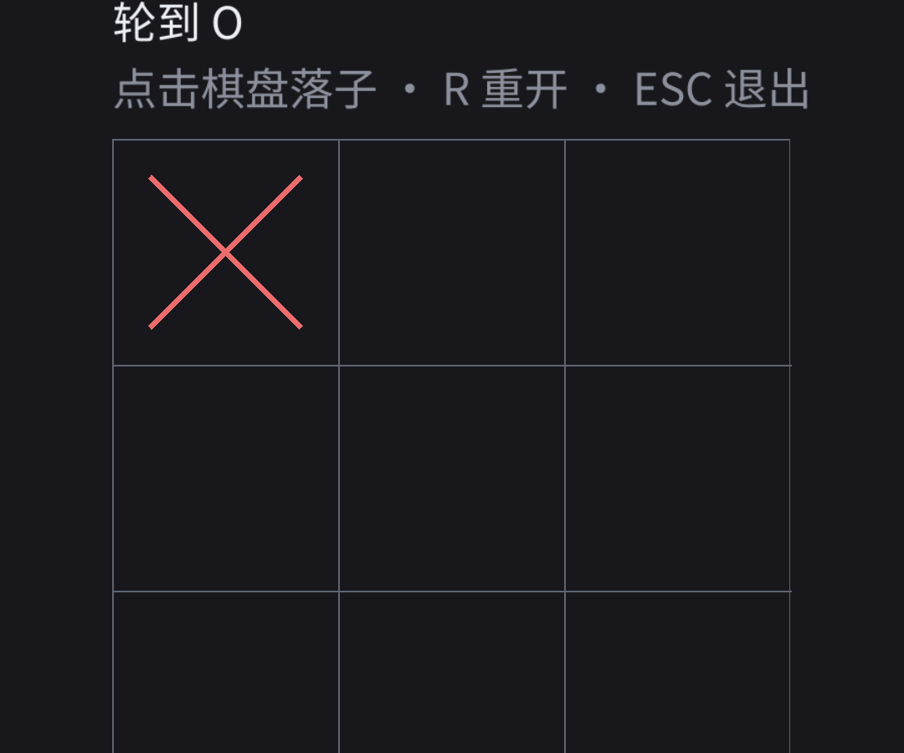

# Android 平台代码核对（P3-T7 ~ T11）

> 目的：在拿到 Android 设备之前，先用**源码证据**核对"移动端必需的行为"是否已经成立，
> 把"需要真机才能确认的部分"缩小到最少。
>
> 核对日期：2026-11-02　　依据：SDL3 锁定提交 `b64293b`

---

## T7 生命周期事件（切后台 / 被回收）✅ 代码已就位

`platform_sdl/app.cpp` 的事件分支：

| 事件 | 处理 |
|---|---|
| `SDL_EVENT_WILL_ENTER_BACKGROUND` | `saveNow()` 落盘 |
| `SDL_EVENT_TERMINATING` | `saveNow()` 最后一次保存 |
| `SDL_EVENT_LOW_MEMORY` | 释放文字纹理缓存 + `saveNow()` |
| `SDL_EVENT_DID_ENTER_BACKGROUND` / `WILL/DID_ENTER_FOREGROUND` | 忽略（无需处理） |
| `SDL_EVENT_RENDER_DEVICE_RESET` | 丢弃失效纹理，下次绘制重建 |

Android 会发送上述事件（SDL 的 Android 后端在 Activity 生命周期回调里投递）。
**结论**：代码满足要求，真机只需确认"切后台 → 被杀 → 重进 → 局面恢复"（T12）。

---

## T8 资源从 APK assets 加载 ✅ 代码已修，待真机确认

**关键事实**（源码证据，修正了路线图早期记录的错误结论）：

```c
// src/filesystem/android/SDL_sysfilesystem.c
char *SDL_SYS_GetBasePath(void) { return SDL_strdup("assets://"); }
```

**Android 与 HarmonyOS 一样返回 `assets://`**，不是早期记录的 `"./"`。
SDL3 中 `assets://` 的解析同时覆盖 `SDL_PLATFORM_ANDROID` 与 `SDL_PLATFORM_OPENHARMONY`。

因此 `SDLAssetIO` 的规则修正为：

```
base="assets://", name="fonts/NotoSansSC-Regular.ttf"
  ->  "assets://fonts/NotoSansSC-Regular.ttf"
```

（旧实现会拼成 `assets:///assets/fonts/...`，必然失败。）

APK 中确已包含 `assets/fonts/NotoSansSC-Regular.ttf` 与 `assets/sounds/*.wav`
（由 CI 的「校验 APK 内含原生库」步骤断言）。

**剩余**：真机确认字体与音效实际加载成功（T12 一并做）。

---

## T9 安全区 ✅ 代码已就位，SDL 已提供数据

Android 侧数据链路（源码证据）：

```
SDLSurface.onApplyWindowInsets (Java)
  -> SDLActivity.onNativeInsetsChanged(left, right, top, bottom)
  -> Android_SetWindowSafeAreaInsets()
  -> SDL_SetWindowSafeAreaInsets(window, ...)
```

我们的 `App::rebuildLayout()` 读取 `SDL_GetWindowSafeArea()`，
按渲染缩放折算成逻辑单位后注入 `Layout`（用于计算避让与居中的可用区域）。

**注意**：不使用 `SDL_SetRenderViewport` 实现安全区 —— 那会把可视区域裁掉，
而不是让布局避让。这一点在 P2 已确认。

---

## T10 输入复用 ✅ 已核对，并修了一处时序隐患

统一路径（与桌面完全相同）：

```
SDL_ConvertEventToRenderCoordinates()   ← 唯一坐标换算点
   -> Layout::cellAt()                  ← 唯一命中判定
   -> Game::applyMove()                 ← 唯一状态变更
```

去重：同一次指针交互在抬起前不会重复落子（`lastCell_` 守卫）；
`SDL_EVENT_FINGER_*` 被显式忽略，避免"触摸 + 合成鼠标"落两子。

**本次修正**：把两条 hint 的设置从 `SDL_Init()` 之后移到**之前**。

原因是核对时发现：`SDL_HINT_TOUCH_MOUSE_EVENTS` 的效果依赖
SDL 鼠标子系统的 hint 回调（`SDL_AddHintCallback` 在 Init 期间注册）。
虽然 `SDL_SetHintWithPriority` 会同步派发回调（实测代码确认），
但"先注册后设置"是隐含时序；在 Init 前设置则不依赖任何时序。

---

## T11 JNI 边界与内存归属 ✅ 无需改动，仅记录

**本项目没有自己编写的 JNI 代码**：所有 JNI（Activity ↔ 原生、输入、音频、
传感器）都由 SDL 的 `org.libsdl.app.*` 与 `src/core/android/SDL_android.c` 承担。
我们只写了一个 `MainActivity`（覆写 `getLibraries()`），其中没有 JNI 调用，
也就不需要 try/catch 兜底。

内存归属规则（本项目遵守的部分）：

| 资源 | 分配方 | 释放方 |
|---|---|---|
| `SDL_GetPrefPath()` 返回的字符串 | SDL | 调用方 `SDL_free()` |
| `SDL_GetBasePath()` 返回值 | SDL（静态） | **不可释放** |
| `SDL_LoadWAV_IO` 的 PCM 缓冲 | SDL | 调用方 `SDL_free()` |
| `SDL_Surface` / `SDL_Texture` / `SDL_AudioStream` | SDL | 对应的 `SDL_Destroy*` |
| 线程 | SDL 在主线程调用 App 回调 | —— |

渲染与 UI 均在 SDL 的主线程回调内执行，不跨线程操作。

---

## 小结

| 任务 | 状态 | 是否需要真机 |
|---|---|---|
| T7 生命周期 | ✅ 代码就位 | 需真机确认恢复行为（T12） |
| T8 资源加载 | ✅ 代码已修 | **是**（真机加载字体/音效） |
| T9 安全区 | ✅ 代码就位 + SDL 提供数据 | 建议真机看刘海/状态栏避让 |
| T10 输入复用 | ✅ 本次修正时序隐患 | 需真机确认不落两子（T12） |
| T11 JNI 边界 | ✅ 无自有 JNI，仅记录规则 | 否 |

因此 Android 剩余工作集中在 **T12（真机行为验证）** 与 **T13（签名/AAB）**，
两者都需要一台 Android 设备或模拟器。

---

## 附：模拟器实测结果（API 35 / arm64，2026-11-03）



本地用 `adb` 完成全流程闭环，结果：

| 项 | 结果 | 证据 |
|---|---|---|
| 字体加载 | ✅ | 日志 `资源已加载: assets://fonts/NotoSansSC-Regular.ttf` |
| 音效加载 | ✅ | 三个 WAV 均来自 `assets://sounds/...` |
| 点击落子 | ✅ | 一次触摸只落一子，存档 `TTT1,X........,O,1` |
| 切后台存档 | ✅ | `已保存: save.txt（TTT1,X........,O,1）` |
| 低内存处理 | ✅ | `LOW_MEMORY → 释放缓存并保存对局` |
| 冷启动恢复 | ✅ | `已恢复对局: 手数=1，状态=0`，画面显示 X 与「轮到 O」 |

### 期间修复的真实缺陷

**安全区内缩没有考虑 letterbox 偏移**：

- 竖屏手机上，900×900 的逻辑方形被居中放进 1080×2400 的窗口，
  状态栏/手势条位于方形之外；
- 原实现把安全区像素直接除以缩放当作逻辑内缩，
  导致顶部/底部被多扣了一大块 → 棋盘从 675 缩到 462 逻辑单位、
  提示文字右移后在右侧溢出被截断；
- 改为「安全区 ∩ 逻辑呈现区域」后恢复正常（`rebuildLayout`）。

> 这条属于路线图 T20 所说的"若有改动，回到 P2 修抽象"：
> 布局本身没错，错在"安全区 → 逻辑单位"的换算假设了 `逻辑区域 == 整个窗口`。

---

## 补充：移动端没有键盘，「R 重开 / ESC 退出」不可执行（已修复）

手动测试时发现的真实缺陷：提示文案写死了键盘快捷键，手机上根本无法照做。

### 修复方案

| 平台 | 提示文案 | 重开方式 |
|---|---|---|
| 桌面 | `点击棋盘落子 · R 重开 · ESC 退出` | 键盘 `R` |
| 触屏 | `点击棋盘落子 · 双击这行字重开` | **双击提示行** |

- 是否触屏按**视频驱动**判定（`android` / `uikit` / `openharmony`），
  而不是"有没有触摸设备"——带触摸屏的 Windows 笔记本仍可用键盘。
- 退出交给系统：Android 用返回键，iOS 不允许应用自行退出。
- 双击判定放进 `core`（`ttt::isDoubleTap`），阈值 450ms / 48 逻辑单位，
  由单元测试覆盖边界（`core/tests/test_tap.cpp`）。

### 验证（模拟器实测，存档内容为权威判据）

| 操作 | 存档内容 |
|---|---|
| 双击重开后 | `TTT1,.........,X,0`（空盘） |
| 落两子后 | `TTT1,XO.......,X,2` |
| 再双击重开后 | `TTT1,.........,X,0`（回到空盘） |
