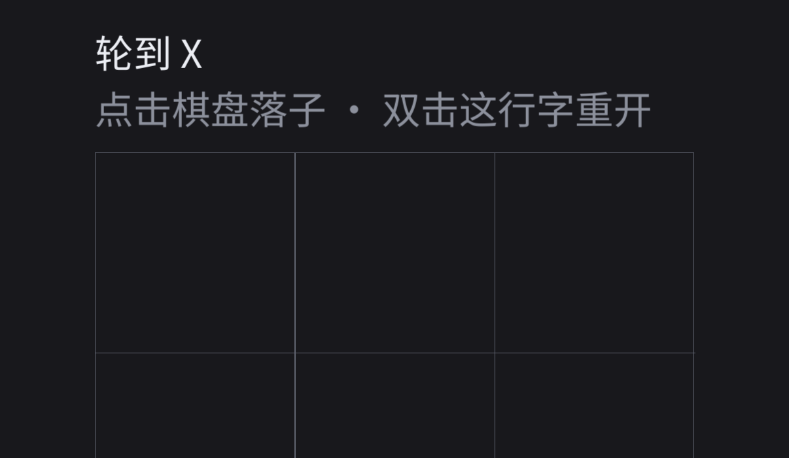

# iOS 工程（P3-T14 ~ T19）

## 设计选择：源码静态链接，不用 xcframework

SDL 官方推荐 `SDL3.xcframework` + Xcode 工程。本项目选择**从源码构建**：

| 方案 | 本项目为何不选/选 |
|---|---|
| xcframework + Xcode 工程 | 需要 Xcode GUI/工程文件；分发前还要**移除嵌入的 framework**（T19 的负担） |
| **源码静态链接（本方案）** | 与桌面/Android 共用同一份源码与 CMake；Ninja 即可构建；无嵌入 framework 问题 |

## 构建

```bash
cmake -S ios -B build-ios-sim -G Ninja \
  -DCMAKE_SYSTEM_NAME=iOS \
  -DCMAKE_OSX_SYSROOT=iphonesimulator \
  -DCMAKE_OSX_ARCHITECTURES=arm64 \
  -DCMAKE_OSX_DEPLOYMENT_TARGET=16.0 \
  -DCMAKE_C_COMPILER="$(xcrun -find clang)" \
  -DCMAKE_CXX_COMPILER="$(xcrun -find clang++)" \
  -DBUILD_SHARED_LIBS=OFF

cmake --build build-ios-sim
```

产物：`build-ios-sim/cjing.app`

## 安装到模拟器

```bash
xcrun simctl boot "iPhone 17 Pro"
xcrun simctl install booted build-ios-sim/cjing.app
xcrun simctl launch booted com.timelightspeed.cjing
xcrun simctl io booted screenshot /tmp/ios.png
```

## 两个必须知道的坑

### 1. SDL_ttf 的 GL 文本引擎在 iOS 上编译不过

`SDL_opengl.h` 在 iOS 上整份是空的（源码注释：*No OpenGL on iOS*），
而 SDL_ttf 无条件编译 `src/SDL_gl_textengine.c` → 缺少 `GLuint` 等类型。

本项目只用 surface 渲染路径（`TTF_RenderText_Blended`），
因此在 `CMakeLists.txt` 里把该文件从目标源列表剔除（不改 vendored 源码）：

```cmake
list(FILTER _srcs EXCLUDE REGEX "SDL_gl_textengine\\.c$")
```

### 2. 安全区单位：点 vs 像素

- `SDL_GetWindowSafeArea()` 在 iOS 返回**点**（402×874）
- 逻辑呈现矩形是**像素**（1206×1206）

直接相减会把底部内缩算成 800+，可用高度变负 → 棋盘 0×0。
必须先按 `ppu = 呈现宽度 / 窗口宽度` 换算到像素空间（见 `rebuildLayout`）。

## 已验证（iPhone 17 Pro 模拟器 / iOS 26.5）



| 项 | 结果 |
|---|---|
| 构建 | ✅ CMake + Ninja，无 Xcode 工程 |
| 启动 | ✅ 进程存活，SDL 视频驱动 `uikit` |
| 中文字体 | ✅ 从 `.app/assets/fonts/` 加载 |
| 音效 | ✅ 三个 WAV 均加载 |
| 布局 | ✅ 棋盘 684×684（正方形），DPI 3x 下文字清晰 |
| 触屏文案 | ✅ 自动显示「双击这行字重开」 |

## 待办（T15~T19 剩余）

- 签名：需要你的 Apple 开发者账号（Team ID），模拟器不需要
- `PrivacyInfo.xcprivacy` 隐私清单（T16）
- Archive / IPA 导出验证（T19）

## 为什么 Xcode 直接打开 `ios/` 不能编译

`ios/` 里**没有 `.xcodeproj`**，只有 `CMakeLists.txt`、`Info.plist.in`、
`PrivacyInfo.xcprivacy`、`README.md`。Xcode 打开一个目录时不会"猜"出 CMake 工程，
所以既没有 target 也没有 scheme，Run 按钮是灰的。

正确顺序是：**先用 CMake 生成 Xcode 工程，再打开生成物**。

## 用 Xcode 构建与调试（交互式）

命令行 Ninja 适合 CI；交互式调试用 Xcode 更方便（断点、调试器、Instruments）：

```bash
./scripts/ios-xcode.sh            # 生成并打开模拟器版工程
./scripts/ios-xcode.sh device     # 生成真机版工程（需在 Xcode 里配 Team）
```

打开后：选 scheme `cjing` → 选模拟器 → `Cmd + R`。

- 生成目录 `build-ios-xcode/`，与 Ninja 的 `build-ios-sim/` **互不影响**
- 改 `CMakeLists.txt` 后 Xcode 会通过 `ZERO_CHECK` 自动重跑 cmake
- 产物：`build-ios-xcode/Debug-iphonesimulator/cjing.app`

## 为什么 iOS 只有可执行文件，没有 `.so`

| 平台 | 产物 | 原因 |
|---|---|---|
| Android | `libmain.so` + `libSDL3.so` + `libSDL3_ttf.so`（每个 ABI 一套） | 应用进程只能 `dlopen` 动态库，不能 exec ELF；`SDLActivity` 按名字加载 |
| iOS | 单一可执行文件 `cjing` | 静态链接，无嵌入库 → 不需要 Embed & Sign，也没有"Archive 前移除 framework"的步骤 |

关键开关就是配置里的 `-DBUILD_SHARED_LIBS=OFF`：
不加它，SDL3 在 iOS 上默认生成 dylib（见 SDL3 `CMakeLists.txt:233` 的分支）。

## 排障：Xcode 构建后文字变大、iPad 两侧大片留白

**症状**：用 Xcode 工程构建运行时，文字比预期大、行间距很宽；iPad 上画面只占中间一条，两侧大片留白。

**原因**：应用跑在 iOS 的「兼容模式」。当 Info.plist 缺少
`UILaunchScreen` 或 `UIDeviceFamily` 时，系统会按老版本兼容模式运行：
分辨率被限制（典型窗口 320×480），界面被整体放大，iPad 上就表现为居中 + 大留白。

**为什么 Ninja 构建正常、Xcode 构建异常**：
CMake 的 Xcode 生成器可能改用自己生成的 Info.plist，导致上述键丢失。

**已做的修复**（`ios/CMakeLists.txt`）：

```cmake
configure_file(Info.plist.in ${CMAKE_CURRENT_BINARY_DIR}/Info.plist @ONLY)
set_target_properties(cjing PROPERTIES
    MACOSX_BUNDLE_INFO_PLIST "${CJING_INFO_PLIST}"          # Ninja 等
    XCODE_ATTRIBUTE_GENERATE_INFOPLIST_FILE "NO"            # Xcode：禁用自动生成
    XCODE_ATTRIBUTE_INFOPLIST_FILE "${CJING_INFO_PLIST}"    # Xcode：用同一份
    XCODE_ATTRIBUTE_TARGETED_DEVICE_FAMILY "1,2")           # iPhone + iPad
```

**验证方法**：运行后看控制台第一行布局日志。

```
正常（iPad）：window=806x1210  output=1612x2420  逻辑=900x1351(竖屏)
兼容模式    ：window=320x480   output=640x960
```

看到 320×480 就说明 plist 仍未被采用，需要重新生成工程：

```bash
rm -rf build-ios-xcode
./scripts/ios-xcode.sh
```
