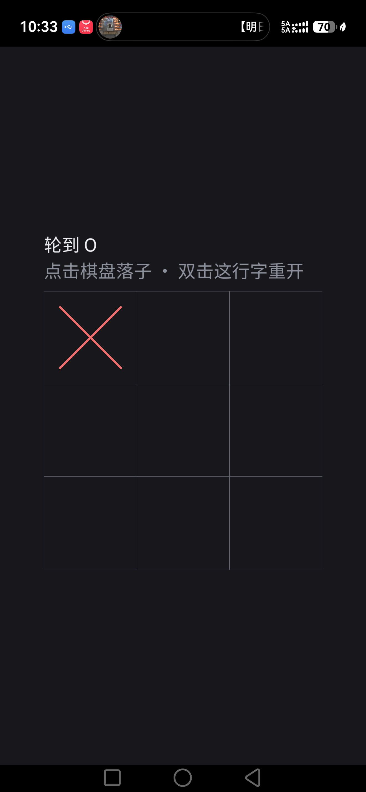

# HarmonyOS 正式工程

从 `precheck/` 进化而来：预检工程验证了「平台能跑 SDL + TTF + 中文」，
本工程把**产品源码**接进来。

## 与 Android 的相似性（经验直接复用）

| 方面 | 做法 |
|---|---|
| 产物 | **共享库 `libmain.so`**（不是可执行文件） |
| 加载方式 | SDL 的鸿蒙入口 `dlopen("libmain.so")` 后找 `SDL_main` / 回调 |
| SDL 依赖 | `add_subdirectory(SDL)` 源码编译，随包打入 |
| 资源 | `resources/rawfile/`，运行时 `SDL_GetBasePath()` 返回 `assets://` |
| 工具链 | CMake + 官方 SDK（DevEco） |

## 准备

```bash
./platform_ohos/app/setup.sh
```

做两件事：

1. 把 `.tools/sdl3-src`、`.tools/sdltff-src` 软链到 `entry/src/main/cpp/`
2. 把 `assets/` 复制到 `entry/src/main/resources/rawfile/`

> 软链与 rawfile 副本都不入库（见 `.gitignore`）。

## 构建

```bash
cd platform_ohos/app
export JAVA_HOME=/Applications/DevEco-Studio.app/Contents/jbr/Contents/Home
export DEVECO_SDK_HOME=/Applications/DevEco-Studio.app/Contents/sdk
/Applications/DevEco-Studio.app/Contents/tools/hvigor/bin/hvigorw assembleHap \
  --mode module -p product=default -p buildMode=debug --no-daemon
```

产物：`entry/build/default/outputs/default/entry-default-unsigned.hap`

> **签名与否决定产物**：
> - 未配置签名 → `entry-default-unsigned.hap`：**只能装模拟器**，真机报 `no signature file`
> - 配置签名 → `entry-default-signed.hap`：可装真机
>
> 签名材料不入库，启用步骤见下方「⚠️ 签名配置的坑」。
> 仓库默认是未签名状态。

## 安装与运行

```bash
HDC=/Applications/DevEco-Studio.app/Contents/sdk/default/openharmony/toolchains/hdc
$HDC install entry/build/default/outputs/default/entry-default-unsigned.hap
$HDC shell aa start -a EntryAbility -b com.timelightspeed.cjing
```

真机需要：**USB 连接 + 解锁 + 允许调试**。

## 日志与截图

```bash
$HDC hilog | grep -E "\[Cjing\]|SDL"
$HDC shell snapshot_display -f /data/local/tmp/shot.jpeg
$HDC file recv /data/local/tmp/shot.jpeg ./shot.jpeg
```

## 验证结果（模拟器 API 26 + 真机，2026-11-04）


| 项 | 结果 | 证据 |
|---|---|---|
| 构建 | ✅ | `hvigorw assembleHap` → unsigned HAP 27MB |
| 安装 | ✅ | 未签名 HAP 可安装（真机则要求签名，见下） |
| 中文渲染 | ✅ | 画面「轮到 X / 点击棋盘落子 · 双击这行字重开」 |
| 棋盘布局 | ✅ | 正方形，居中，无裁切 |
| 触摸落子 | ✅ | `uitest uiInput click` 后 X 落在左上格，状态转「轮到 O」 |
| 双击重开 | ✅ | 两次点击提示行后棋盘清空（截图 `ohos-restart.png`） |
| 切后台存档 | ✅ | `files/Cjing/save.txt` 内容 `TTT1,X........,O,1` |
| 冷启动恢复 | ✅ | 重启后 X 与「轮到 O」正确恢复 |
| 音效 | ⚠️ 未确认 | 应用不依赖音频，缺失时静音运行 |
| 安全区 | ⚠️ 未确认 | 鸿蒙后端会调用 `SDL_SetWindowSafeAreaInsets`，当前画面未见遮挡 |

### 真机验证（Mate 系列，`6BEUT26106000176`）



| 项 | 结果 | 证据 |
|---|---|---|
| 签名安装 | ✅ | `entry-default-signed.hap` 安装成功 |
| 渲染 | ✅ | 中文、正方形棋盘、1320×2856 全屏 |
| 触摸落子 | ✅ | `uitest uiInput click` → X 落左上格 |
| 双击重开 | ✅ | 点两次提示行 → 棋盘清空 |
| 切后台存档 | ✅ | `files/Cjing/save.txt` = `TTT1,X........,O,1` |
| 冷启动恢复 | ✅ | 重启后 X 与「轮到 O」都在 |

## ⚠️ 签名配置的坑（出现过两次，务必注意）

**症状**：在 DevEco 里点了 *Automatically generate signature*，构建仍报
「未检测到签名配置 / The bundleName ... does not match」。

**根因**：`build-profile.json5` 里 **product 必须显式引用签名配置**：

```json5
"products": [
  {
    "name": "default",
    "signingConfig": "default",   // ← 少了这一行就报「未检测到签名配置」
    ...
  }
]
```

`signingConfigs` 里即使有完整材料（证书路径、密码），**没有这一行引用也不会生效**。

**排查步骤**：

1. 确认 product 里有 `"signingConfig": "default"`
2. 确认 `signingConfigs[0].material` 指向的 `.p12/.cer/.p7b` 存在（`~/.ohos/config/`）
3. 确认 profile 里的 `bundle-name` 与 `AppScope/app.json5` 的 `bundleName` 一致：
   ```bash
   strings ~/.ohos/config/default_app_*.p7b | grep bundle-name
   ```
4. 包名改过之后，旧签名材料会因 bundleName 不匹配而失败，需在 DevEco 里**重新生成**

### 签名材料不入库（当前状态）

`build-profile.json5` 里的 `signingConfigs` 已清空为**注释模板** ——
签名材料含加密后的 keystore 密码，属于机器相关的东西，不应提交到公开仓库。

**启用签名的两步**：

1. DevEco Studio → *File → Project Structure → Signing Configs*
   → 勾选 *Automatically generate signature*（登录华为账号）
   —— 这一步会把材料写进 `signingConfigs`，文件落在 `~/.ohos/config/`
2. **手动把这一行加回 products**（DevEco 不会自动加，这是最常见的问题）：

```json5
"signingConfig": "default",
```

未配置签名时，命令行构建产出 `entry-default-unsigned.hap`：
模拟器可安装，**真机拒装**（`no signature file`）。

### 应用名称

| 工程 | 桌面显示名 | 定义位置 |
|---|---|---|
| `platform_ohos/app` | **井字棋** | `AppScope/.../string.json` 的 `app_name` + `entry/.../string.json` 的 `EntryAbility_label` |
| `platform_ohos/precheck` | **井字棋预检** | 同上（历史工程，用于区分） |

改包名后记得同步：签名 profile 里的 `bundle-name` 必须与 `AppScope/app.json5` 的
`bundleName` 一致，否则签名失败。

## 调试提示

- 应用日志：`hdc shell hilog -x | grep -iE "cjing|SDL"`（SDL 的 `SDL_Log` 不一定进 hilog）
- 触摸注入：`hdc shell uitest uiInput click <x> <y>`
- 按键注入：`hdc shell uitest uiInput keyEvent Home`
- 截图：`hdc shell snapshot_display -f /data/local/tmp/s.jpeg` + `hdc file recv`
- 存档路径：`/data/app/el2/100/base/com.timelightspeed.cjing/files/Cjing/save.txt`

---

## 设备矩阵实测（2026-11-05）

| 设备 | API | 类型 | 结果 |
|---|---|---|---|
| 真机 SLY-AL00 | 26 | phone | ✅ 完整可用（需签名） |
| 模拟器 | 26 | phone | ✅ 完整可用 |
| 模拟器 | 24 | 2in1（电脑） | ⚠️ 可用，见下 |
| 模拟器 | 24 | phone / tablet | ❌ **黑屏**（仅有背景色，点击有声） |
| 模拟器 | 16 | phone | ❌ 启动崩溃（历史问题） |

### 黑屏（API24 手机/平板）

日志显示应用完全正常：布局算出 684×684、音频设备打开、点击有音效，
渲染器后端与能正常显示的 API26 设备**完全相同**（`opengles2`）。

同样的构建在 2in1（API24）和 phone（API26）上正常 → 是这两个**模拟器镜像的
图形栈**（DGLES 翻译层）问题，应用侧无法修复。

尝试过改用 SDL 的 `gpu`（Vulkan）后端绕开：

```
[Cjing] gpu 后端不可用（No supported SDL_GPU backend found!），回退默认后端
```

API24 模拟器没有可用的 GPU 后端，回退后仍黑屏，该实验已回退。

### 2in1（电脑）适配

修了一个**代码级缺陷**：安全区换算把「逻辑呈现宽度 / 窗口宽度」当作 DPI 缩放，
而横屏窗口的 letterbox 是由**高度**决定的 → ppu 算成 0.63（实际 1.0），
内缩被放大，棋盘从 684 缩到 396。改用 `SDL_GetWindowSizeInPixels / SDL_GetWindowSize` 后正常。

另外，2in1 模拟器**不向 SDL 暴露键盘和鼠标**（`键盘 0，鼠标 0`），
因此仍显示触屏文案「双击这行字重开」。真实 PC 有键鼠时会自动切换为键盘文案。

## 音效延迟（0.5~1 秒）：已优化到 20ms 缓冲

### 根因

SDL 的鸿蒙音频后端（`src/audio/ohaudio/SDL_ohaudio.c`）在建流后执行：

```c
device->sample_frames = OH_AudioRenderer_GetFrameSizeInCallback(...);   // 实测 4096 帧
```

即**直接采纳系统给的帧数**（4096 帧 ≈ 93ms），并且从不调用
`OH_AudioStreamBuilder_SetFrameSizeInCallback`。因此
`SDL_HINT_AUDIO_DEVICE_SAMPLE_FRAMES` 在这条路径上无效（该文件里按 hint
设置缓冲的代码还是 AAudio 时代的，已被 `#if 0` 停用）。

SDL 内部还会缓冲 3 个这样的块 ≈ 280ms，再叠加系统管线 → 用户听到 0.5~1 秒。

### 处理

`scripts/patch-sdl-ohos-audio.py` 给该文件打一个**幂等补丁**，
在设置延迟模式之后显式指定回调帧数：

```c
#ifdef CJING_OHOS_AUDIO_FRAMES
    OH_AudioStreamBuilder_SetFrameSizeInCallback(builder, (int32_t)CJING_OHOS_AUDIO_FRAMES);
#endif
```

- 帧数由 CMake 宏 `CJING_OHOS_AUDIO_FRAMES` 传入（默认 512）
- 只在鸿蒙构建定义，其它平台编译结果不变
- `setup.sh` 会自动执行补丁脚本

**实测**：缓冲 4096 帧（93ms）→ **882 帧（20ms）**，SDL 三层缓冲从约 280ms 降到约 60ms。

> 未验证：真机需解锁屏幕才能安装/启动，实际听感请人工确认。

---

## 自适应排布（手机 / 平板 / 电脑 / 自由窗口）

逻辑画布不再是固定 900×900：**短边固定 900，长边跟随窗口宽高比**。
Layout 按可用区高宽比选择两种排布：

| 模式 | 触发 | 布局 | 典型设备 |
|---|---|---|---|
| 竖屏 | 高 ≥ 宽×1.15 | HUD 在棋盘上方 | 手机 |
| 宽屏 | 宽 > 高×1.15 | 棋盘靠左、HUD 在右侧一列 | 平板横屏、电脑、自由窗口 |

实测（桌面 1600×900）：棋盘 822×822 靠左，状态与提示完整显示在右侧；
手机（1320×2031）：棋盘 792×792（改造前 684），HUD 在上方。

关键点：**HUD 列宽由实际文字宽度决定**。App 先用 `SDLView::textLogicalSize()`
量出提示行宽度，再传给 `Layout::compute(..., hudMinWidth)`；
Layout 保证棋盘不把文字挤出窗口（不够就缩棋盘，并留 16 单位余量）。

调试用环境变量：

```bash
CJING_WINDOW=1600x900 ./CjingApp          # 指定初始窗口尺寸
CJING_WINDOW=1600x900 CJING_SHOT=/tmp/w.bmp ./CjingApp   # 渲染 30 帧后自截图并退出
```

### HUD 提示折行（宽屏）

宽屏模式把提示放在右侧一列。若按单行排布，一句长提示会占掉 ~700 单位，
把棋盘挤到 420（iPad 横屏实测）。现在**按 ` · ` 断行**：

| 场景 | 棋盘 | 提示 |
|---|---|---|
| iPad 横屏 1200×900（折行前） | 420 | 单行，占 736 宽 |
| iPad 横屏 1200×900（折行后） | **771** | 两行：「点击棋盘落子」/「双击这行字重开」 |
| iPhone 竖屏 | 792 | 仍是单行（宽度足够） |

实现：
- `SDLView::drawTextWrapped()` / `measureTextWrapped()`：按 ` · ` 分段、贪心装箱
- `Layout` 的 HUD 列不再按单行文字宽度扩张（32% 封顶，下限 240）
- 宽屏命中带高度 110（两行），竖屏 64（一行）

## 状态栏 / 导航栏（沉浸式外观）

鸿蒙上 SDL 的后端**完全没有处理系统栏**（源码里连安全区设置都是
`#if 0 // !!! FIXME`），因此状态栏用系统默认底色（白或黑），
与深色画布割裂 —— Android/iOS 上不会这样。

### 当前做法：系统栏跟随应用背景色

在 `EntryAbility.ets` 里从 `onCreate` 异步取主窗口，设置：

```ts
win.setWindowSystemBarProperties({
  statusBarColor: '#18181C',            // 与画布背景一致
  statusBarContentColor: '#FFFFFF',     // 图标/文字白色
  navigationBarColor: '#18181C',
  navigationBarContentColor: '#FFFFFF'
});
```

为什么不在 `onWindowStageCreate` 里做：SDL 会把自己的原生实现挂到 ability
的原型上，接管 `onForeground` / `onWindowStageCreate` 等回调，覆盖不了。

### 为什么没做"真沉浸式"（内容铺到状态栏下）

那需要**安全区内缩**数据，而 SDL 的鸿蒙窗口层把 `SDL_SetWindowSafeAreaInsets`
调用注释掉了（`SDL_openharmonywindow.c:111`）。没有内缩，内容会压到状态栏下面。

要真正实现，需要：
1. 在 ArkTS 侧用 `window.getWindowAvoidArea()` 取内缩；
2. 通过 NAPI 传给原生（需要给 libmain.so 加 NAPI 导出）；
3. 或修 SDL：让鸿蒙窗口层把 avoidArea 填进 `SDL_SetWindowSafeAreaInsets`。

在拿到内缩之前，让状态栏颜色与画布一致是风险最低的做法。
