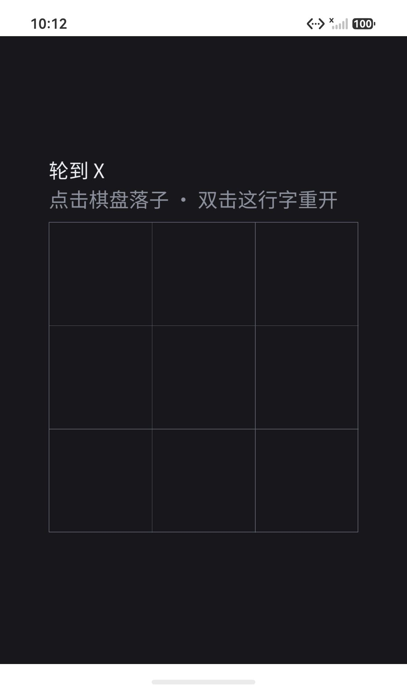

# HarmonyOS 正式工程

从 `precheck/` 进化而来：预检工程验证了「平台能跑 SDL + TTF + 中文」，
本工程把**产品源码**接进来。

## 与 Android 的相似性（经验直接复用）

| 方面 | 做法 |
|---|---|
| 产物 | **共享库 `libmain.so`**（不是可执行文件） |
| 加载方式 | SDL 的鸿蒙入口 `dlopen("libmain.so")` 后找 `SDL_main` / 回调 |
| SDL 依赖 | `add_subdirectory(SDL)` 源码编译，随包打入 |
| 资源 | `resources/rawfile/`，运行时 `SDL_GetBasePath()` 返回 `assets://` |
| 工具链 | CMake + 官方 SDK（DevEco） |

## 准备

```bash
./platform_ohos/app/setup.sh
```

做两件事：

1. 把 `.tools/sdl3-src`、`.tools/sdltff-src` 软链到 `entry/src/main/cpp/`
2. 把 `assets/` 复制到 `entry/src/main/resources/rawfile/`

> 软链与 rawfile 副本都不入库（见 `.gitignore`）。

## 构建

```bash
cd platform_ohos/app
export JAVA_HOME=/Applications/DevEco-Studio.app/Contents/jbr/Contents/Home
export DEVECO_SDK_HOME=/Applications/DevEco-Studio.app/Contents/sdk
/Applications/DevEco-Studio.app/Contents/tools/hvigor/bin/hvigorw assembleHap \
  --mode module -p product=default -p buildMode=debug --no-daemon
```

产物：`entry/build/default/outputs/default/entry-default-unsigned.hap`

> **签名暂未配置**：`build-profile.json5` 里已移除 `"signingConfig": "default"`，
> 调试阶段用未签名 HAP 直接 `hdc install` 即可（预检阶段已验证可行）。
> 正式签名在 DevEco Studio 的 *Project Structure → Signing Configs* 生成，
> 与 Android/iOS 统一在 P3 收尾时处理。

## 安装与运行

```bash
HDC=/Applications/DevEco-Studio.app/Contents/sdk/default/openharmony/toolchains/hdc
$HDC install entry/build/default/outputs/default/entry-default-unsigned.hap
$HDC shell aa start -a EntryAbility -b com.timelightspeed.cjing
```

真机需要：**USB 连接 + 解锁 + 允许调试**。

## 日志与截图

```bash
$HDC hilog | grep -E "\[Cjing\]|SDL"
$HDC shell snapshot_display -f /data/local/tmp/shot.jpeg
$HDC file recv /data/local/tmp/shot.jpeg ./shot.jpeg
```

## 验证结果（HarmonyOS 模拟器 API 26，2026-11-04）



| 项 | 结果 | 证据 |
|---|---|---|
| 构建 | ✅ | `hvigorw assembleHap` → unsigned HAP 27MB |
| 安装 | ✅ | 未签名 HAP 可安装（真机则要求签名，见下） |
| 中文渲染 | ✅ | 画面「轮到 X / 点击棋盘落子 · 双击这行字重开」 |
| 棋盘布局 | ✅ | 正方形，居中，无裁切 |
| 触摸落子 | ✅ | `uitest uiInput click` 后 X 落在左上格，状态转「轮到 O」 |
| 双击重开 | ✅ | 两次点击提示行后棋盘清空（截图 `ohos-restart.png`） |
| 切后台存档 | ✅ | `files/Cjing/save.txt` 内容 `TTT1,X........,O,1` |
| 冷启动恢复 | ✅ | 重启后 X 与「轮到 O」正确恢复 |
| 音效 | ⚠️ 未确认 | 应用不依赖音频，缺失时静音运行 |
| 安全区 | ⚠️ 未确认 | 鸿蒙后端会调用 `SDL_SetWindowSafeAreaInsets`，当前画面未见遮挡 |

> **真机注意**：真机上未签名 HAP 会被拒绝（`error: no signature file`），
> 模拟器则允许。真机验证需要先配置签名（DevEco 的 Signing Configs）。

## 调试提示

- 应用日志：`hdc shell hilog -x | grep -iE "cjing|SDL"`（SDL 的 `SDL_Log` 不一定进 hilog）
- 触摸注入：`hdc shell uitest uiInput click <x> <y>`
- 按键注入：`hdc shell uitest uiInput keyEvent Home`
- 截图：`hdc shell snapshot_display -f /data/local/tmp/s.jpeg` + `hdc file recv`
- 存档路径：`/data/app/el2/100/base/com.timelightspeed.cjing/files/Cjing/save.txt`
